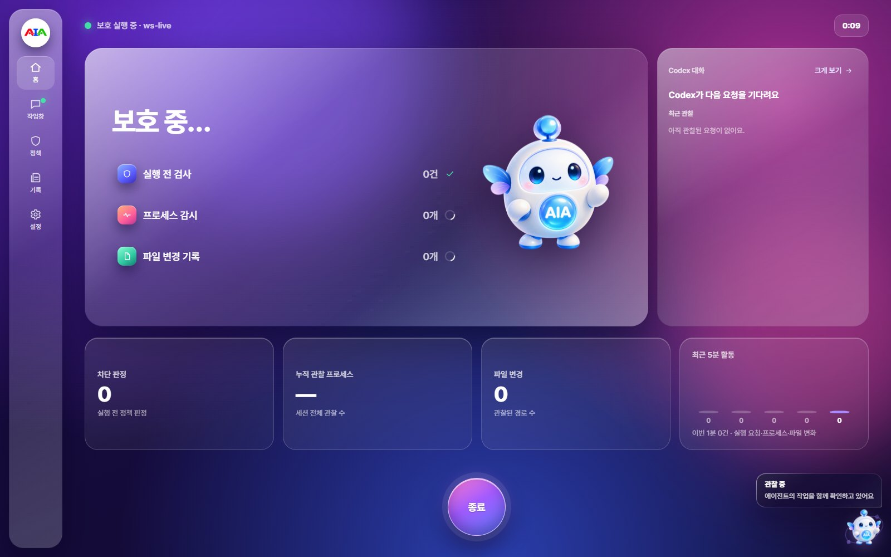
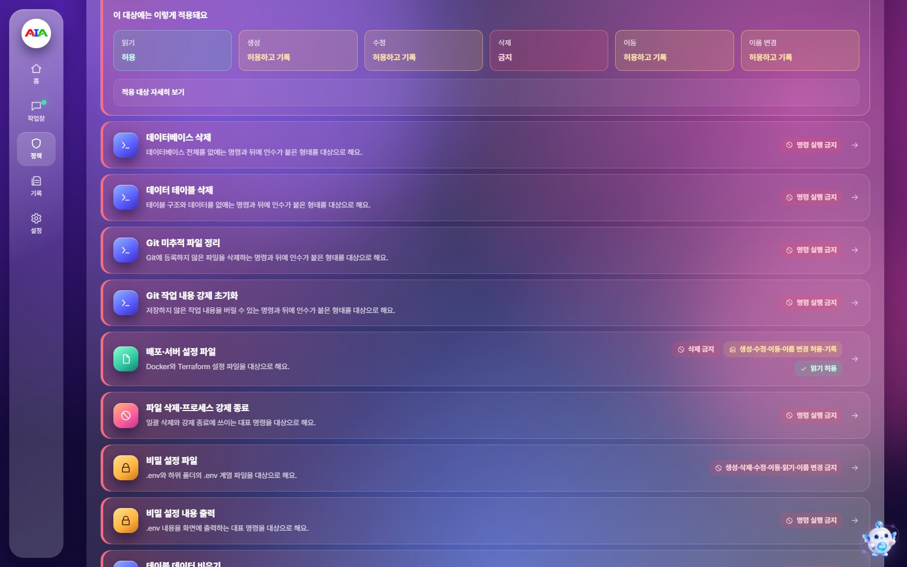

# AIA(아이아): AI 코딩 에이전트를 위한 런타임 보증

[English](README.md) · [빠른 시작](docs/QUICKSTART.md) · [한계](docs/LIMITATIONS.md) · [문서 길잡이](docs/README.md)

AIA(AI Assurance, 아이아)는 OpenAI Codex 코딩 에이전트 바깥에 신뢰 계층을 하나 더
두는 Windows 데스크톱 앱입니다. 에이전트에게는 일에 필요한 권한을 주고, AIA는
작업 폴더 안에서 실제로 무엇을 하는지 지켜봅니다. 정책이 금지한 일은 실행 전에
막고, 증거를 기록하고, 문제가 생기면 폴더를 되돌립니다.

AIA는 에이전트를 믿고 맡기는 대상이 아니라 확인해야 할 고권한 주체로 봅니다(제로
트러스트). 에이전트의 설명이 아니라 관찰한 행동을 근거로 판단합니다.



## 동작 원리

보호 실행을 시작하면 AIA가 Codex를 직접 실행하고, 작업 폴더의 기준점을 저장한 뒤,
서로 독립된 세 센서를 하나의 정책에 연결합니다.

| 구성 | 하는 일 |
|---|---|
| **훅 센서** | Codex가 명령 실행(`Bash`)이나 파일 수정(`apply_patch`) 전에 AIA에 먼저 묻습니다. 정책에 어긋나면 실행 전에 거절합니다. |
| **프로세스 센서** | AIA가 Codex를 직접 실행하므로, 그 아래 생기는 자식·손자 프로세스를 따라가 행동의 출처를 좁힙니다. |
| **파일 센서** | 작업 폴더의 변경을 기록합니다. 실행이 끝나면 폴더를 기준점으로 되돌리고 SHA-256 해시로 그대로 돌아왔는지 확인합니다. |
| **정책** | 기본 정책 네 가지와 사용자 지정 편집기로 파일·명령마다 허용, 허용하고 기록, 금지를 정합니다. 실행마다 꼭 지킬 파일도 지정할 수 있습니다. |

관찰, 판정, 복구는 모두 결과 기록에 남습니다. 실행이 끝나면 기록 파일마다
SHA-256 해시를 목록으로 적어 두고, 나중에 확인할 때 다시 계산해 맞춰 봅니다.
파일이 바뀌면 알아챌 수 있습니다.

## 기능

- **데스크톱 앱에서 보호 실행**: 폴더, 정책, 권한을 고르고 앱 안 대화 창에서
  Codex와 일합니다.
- **Codex 앱과 같은 권한 단계**: 승인 요청, 나 대신 승인, 전체 권한. 어느
  단계에서든 AIA가 명령을 실행 전에 검사합니다.
- **승인 카드**: Codex가 인터넷이나 작업 폴더 밖 쓰기가 필요하면 사람이
  '이번만 허용' 또는 '거절'로 정합니다. 정책으로 금지한 일은 카드에서 풀 수
  없습니다.
- **꼭 지킬 파일**: 고객 DB 같은 파일을 지정하면, 명령으로 지우거나 옮기거나
  덮어쓰는 시도를 실행 전에 거절합니다.
- **외부 도구는 기본으로 꺼짐**: 실행 전 검사를 거치지 않는 MCP 서버, 플러그인,
  앱은 보호 실행에서 꺼 둡니다. Codex 앱에서는 그대로 쓸 수 있습니다.
- **여러 대화방**: 서로 다른 폴더라면 보호 실행을 최대 네 개까지 동시에 엽니다.
  겹치는 폴더는 받지 않습니다. 하나를 되돌리면 다른 작업까지 되돌아가기
  때문입니다.
- **기록과 복구**: 실행마다 증거, 프로세스 트리, 파일 변경, 복구 지점, 무결성
  검증을 보여 주고, 바탕화면의 작은 가디언이 보호 상태를 알려 줍니다.



## 필요한 것

- Windows 11
- 로그인한 [Codex CLI](https://github.com/openai/codex)
- Microsoft Edge WebView2 Runtime(Windows 11에 기본 포함)

소스에서 빌드하려면 Python 3.13, [uv](https://docs.astral.sh/uv/), Node.js 24도
필요합니다.

## 설치

**설치 파일.** `AIA-<버전>-Setup.exe`를 실행합니다. 현재 사용자 계정의
`%LOCALAPPDATA%\Programs\AIA`에 설치되며 관리자 권한이 필요 없습니다. 자세한
내용은 [INSTALL.md](INSTALL.md)에 있습니다.

**소스에서 빌드.**

```powershell
uv sync --group build
.\scripts\build-windows.ps1
```

스크립트가 먼저 화면(`frontend`)을 빌드한 뒤 `dist\windows\AIA\AIA.exe`와 명령줄
도구 `dist\windows\aia-cli\aia-cli.exe`를 만듭니다. 자세한 내용은
[Windows 데스크톱 안내](docs/WINDOWS-DESKTOP.md)에 있습니다.

## 빠른 시작

1. AIA를 엽니다. 홈 화면에서 Codex, 훅, 센서가 준비됐는지 보여 줍니다.
2. 처음 한 번은 앱의 안내에 따라 훅을 연결합니다. AIA가 Codex에 훅을 추가하면,
   Codex의 `/hooks`에서 직접 검토하고 신뢰한 뒤, AIA가 무해한 시험으로
   확인합니다. AIA가 대신 신뢰하지는 않습니다.
3. **보호 시작**을 누르고 이미 있는 폴더, 정책, 권한을 고릅니다. 필요하면 꼭
   지킬 파일을 추가합니다.
4. 대화 창에서 Codex와 일합니다. 보호 패널에 검사, 차단, 프로세스, 파일 변경이
   바로 나타납니다.
5. **작업 종료**를 누르면 결과를 봅니다. 필요하면 폴더를 기준점으로 되돌리고
   무결성 검증 결과를 확인합니다.

자세한 사용법은 [사용자 가이드](docs/USER-GUIDE.md)에, 명령줄(`aia doctor`,
`aia hook verify`, `aia protect`, `aia runs` 등) 사용법은
[명령줄 안내](docs/CLI-GUIDE.md)에 있습니다.

## AIA가 하지 않는 일

AIA는 모든 것을 지킨다고 말하지 않고 한계를 밝힙니다. 요약하면 다음과 같습니다.

- 지정한 작업 폴더만 되돌립니다. 폴더 밖 변경은 되돌리지 않습니다.
- 명령은 글자를 기준으로 판정합니다. 스크립트 안에 숨긴 삭제는 미리 막지 못하고,
  기록한 뒤 사후에 되돌립니다.
- 사용자가 직접 켠 외부 도구는 보호 범위 밖입니다.
- 프로세스 증거는 행동의 출처를 좁혀 줄 뿐, 어떤 프로세스가 파일을 썼는지
  증명하지는 않습니다.
- 기록은 "위조할 수 없다"가 아니라 "바뀌면 알아챌 수 있다"입니다. 서명은
  하지 않으므로, 파일과 해시 목록을 함께 고쳐 쓰면 알아채지 못합니다.
- 지금은 Windows 11과 Codex만 지원합니다.

전체 목록은 [LIMITATIONS.md](docs/LIMITATIONS.md)와 [위협 모델](docs/THREAT-MODEL.md)에
있습니다.

## 문서

- [문서 길잡이](docs/README.md)
- [시스템 구성](docs/SYSTEM-OVERVIEW.md)과 [아키텍처](ARCHITECTURE.md)
- [센서와 정책 기술 문서](docs/technical/AIA-RUNTIME-SECURITY-WHITEPAPER.md)
- [문제 해결](docs/TROUBLESHOOTING.md)
- [변경 기록](CHANGELOG.md)

## 개발

```powershell
uv sync --group dev
npm --prefix frontend ci
.venv\Scripts\python.exe -m pytest -q
uvx ruff@0.15.0 check
npm --prefix frontend test
```

검토 요청(PR) 전에 [CONTRIBUTING.md](CONTRIBUTING.md)를 읽어 주세요. 보안 문제는
[SECURITY.md](SECURITY.md)의 절차로 알려 주세요. 참여하는 모든 사람은
[행동 강령](CODE_OF_CONDUCT.md)을 지켜 주세요.

## 라이선스

AIA는 [Apache License 2.0](LICENSE)으로 배포합니다. 함께 들어 있는 외부 구성 요소는
각자의 라이선스를 따르며 [THIRD-PARTY-NOTICES.md](THIRD-PARTY-NOTICES.md)에 정리되어
있습니다. AIA 이름과 로고는 코드 라이선스의 대상이 아닙니다.
