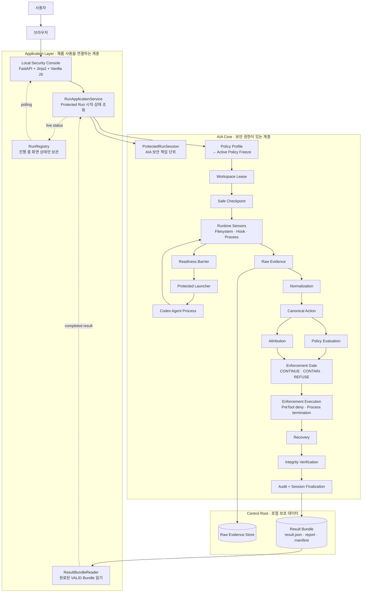
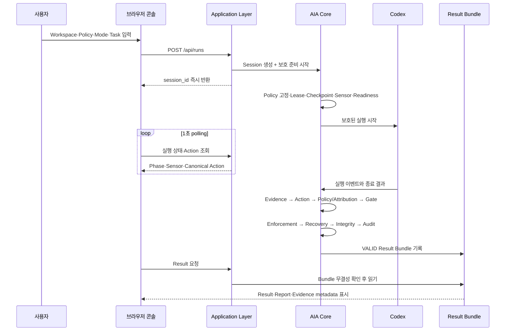

# AIA 시스템 구성도

## 한 문장으로 이해하기

AIA는 Codex를 대신 실행하는 제품이 아니라, 사용자가 지정한 Workspace 안에서 Codex의 실행을 보호하고 실행 증거를 모아 정책·귀속·집행·복구·무결성 결과를 남기는 보안 실행 계층이다.

## 전체 구성



## 사용자가 보는 흐름



## 각 계층의 역할

| 계층 | 하는 일 | 하지 않는 일 |
|---|---|---|
| 브라우저 UI | 입력을 받고 상태와 결과를 보여준다 | Policy 판정, Kill 결정, 복구 성공 판단 |
| Application Layer | 기존 Core API를 연결하고 화면용 DTO로 변환한다 | 새로운 Security Engine 구현 |
| AIA Core | Session, Policy, Evidence, Attribution, Enforcement, Recovery, Integrity를 결정한다 | 화면 디자인 |
| Control Root | Evidence와 Result Bundle을 보존한다 | 임의 파일을 신뢰된 결과로 만들기 |

## 핵심 용어

- **Workspace**: 보호할 프로젝트 디렉터리다.
- **AIA Session**: 보호 실행이 시작된 시점부터 끝날 때까지의 보안 책임 단위다. Workspace와 Agent의 Native Session과는 다르다.
- **Active Policy**: 이번 Session에서 사용할 정책을 시작 시점에 고정한 것이다.
- **Raw Evidence**: Sensor가 관찰한 원시 증거다.
- **Canonical Action**: 여러 증거를 정규화해 만든 하나의 행위 표현이다.
- **Policy Evaluation**: 그 행위가 정책을 위반했는지 판단한다.
- **Attribution**: 그 행위를 Agent에 어느 수준까지 귀속할 수 있는지 판단한다.
- **Enforcement Gate**: CONTINUE, CONTAIN, REFUSE를 결정한다. 실제 프로세스 종료는 Gate 이후의 실행 컴포넌트가 담당한다.
- **Result Bundle**: Session 종료 후 결과·Evidence index·Manifest·Report를 묶은 권위 있는 산출물이다.

## 가장 중요한 경계

```text
GUI가 위험하다고 추측
→ 직접 종료
```

가 아니라 다음 흐름이다.

```text
Raw Evidence
→ Canonical Action
→ Policy Evaluation + Attribution
→ Enforcement Gate
→ 실제 Enforcement Execution
→ Recovery
→ Integrity Verification
→ Audit / Result Bundle
```

따라서 `Policy = VIOLATION`이어도 Attribution이 `PROCESS` 또는 `UNKNOWN`이면 자동 종료를 승인하지 않을 수 있다. `RESTORED`도 무결성 성공을 뜻하지 않으므로, 제품에서 검증된 복구 성공이라고 말하려면 `RESTORED + VERIFIED`를 함께 확인해야 한다.

## 현재 제품을 실행하는 위치

```powershell
cd "C:\workspace\01_projects\aia-mvp"
uv run aia-web
```

그 다음 브라우저에서 `http://127.0.0.1:8787`을 연다. Console은 로컬 사용을 위한 P1 Application Layer이고, 보안 판단의 권위는 계속 AIA Core에 있다.
